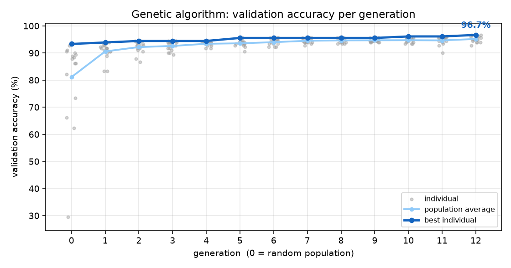

# GA-Designed CNN for Industrial Steel-Surface Defect Detection

A **genetic algorithm that designs a CNN** for classifying hot-rolled steel surface defects (NEU dataset). The evolved network reaches **99.07% test accuracy** and beats both random search on the same compute budget and a hand-designed CNN, with half the parameters of the random-search winner.




**Topics:** genetic algorithms, neuroevolution / architecture search, CNNs and the Neocognitron, hybrid soft computing systems.

## Problem

A steel mill inspects hot-rolled strip with cameras and has to sort each surface defect into its type. A CNN does this well, but **choosing the CNN by hand is guesswork**: how many layers, how many filters, which kernel size, how much dropout, what learning rate? Each choice interacts with the others, and trying them one at a time is slow.

Here a **genetic algorithm** makes those choices. Every candidate network is a chromosome; its **fitness is validation accuracy** after a short training run.

## Approach

```
chromosome ─► decode into a CNN ─► train 5 epochs ─► fitness = validation accuracy
     ▲                                                          │
     └── elitism + tournament selection + crossover + mutation ◄┘   × 12 generations, population 16

GA winner ─► train 40 epochs (3 seeds) ─► test set, scored once
     compared with: random search (same number of networks trained) and a hand-designed CNN
```

### The chromosome ([cnn.py](cnn.py))

| Gene | Values | Type |
|---|---|---|
| number of conv blocks | 1 … 5 | integer |
| filters per block | {8, 16, 32, 64, 128} for each of the 5 possible blocks | ordered choice |
| kernel size | 3×3, 5×5, 7×7 | categorical |
| dense hidden units | none, 32, 64, 128, 256 | ordered choice |
| dropout | 0.0 … 0.6 | real |
| learning rate | 10^−4 … 10^−1.5 (gene = the exponent) | real |

Filter genes for blocks beyond the current depth are carried along but unused, like introns in DNA. If a later mutation adds a block, it inherits a sensible filter count instead of a random one.

**Decoded network (Neocognitron view in brackets):** each block is Conv → BatchNorm → ReLU (**S-cells**: feature extraction), then MaxPool 2×2 (**C-cells**: tolerance to small shifts). Then global average pooling → dropout → optional dense layer → 6-class softmax. Fukushima's Neocognitron (1980) alternated S- and C-cell layers the same way. A modern CNN adds backprop training on top.

### The GA ([ga.py](ga.py))

| Operator | Choice |
|---|---|
| Fitness | validation accuracy after 5 epochs (ties broken by lower validation loss) |
| Selection | tournament, size 3 |
| Crossover | uniform, rate 0.9: each gene comes from either parent with probability ½ |
| Mutation | 0.2 per gene. Integer/ordered genes step to a neighbouring value, the kernel is redrawn, real genes get Gaussian noise |
| Elitism | best 2 survive unchanged |
| Cache | a network already trained is never trained again (saved 28 trainings) |
| Diversity | no two identical networks inside one population |

| File | What it is |
|---|---|
| [cnn.py](cnn.py) | Genome, the CNN it decodes into, Grad-CAM (on the last conv block, before its pooling) |
| [ga.py](ga.py) | GA operators, evolution loop, random-search baseline |
| [trainer.py](trainer.py) | Adam + cosine LR decay, flip/transpose augmentation, keeps the best-validation epoch |
| [data.py](data.py) | Loads the whole dataset onto the GPU once (64×64, normalised) |
| [evolve.py](evolve.py) | All experiments below; writes `models/` and `results/` |
| [plots.py](plots.py) | GA curve, architecture diagram, confusion matrix, prediction grid |
| [app.py](app.py) | Gradio web demo |

## Data

The **NEU surface defect database** (Song & Yan, Northeastern University) contains hot-rolled steel strip images, 200×200 grayscale, in 6 classes: **crazing, inclusion, patches, pitted surface, rolled-in scale, scratches**. `download_data.py` fetches a public Hugging Face mirror (pixel-identical to the original, with 3 duplicates removed, so no Kaggle login is needed). The mirror's split is used:

| Split | Images | Used for |
|---|---|---|
| train | 1,437 | training every candidate |
| validation | 180 | **GA fitness** and choosing the best epoch |
| test | 180 (30 per class) | **only once**, at the very end |

The test images never influence the search, so the test accuracy is an honest estimate.

## Results (`python evolve.py`, RTX 3050 laptop GPU, ~15 min in total)

### 1. The GA improves generation by generation

| | Generation 0 (random) | Generation 12 |
|---|---|---|
| Best validation accuracy | 93.3% | **96.7%** |
| Population average | 81.1% | **95.2%** |
| Worst individual | 29.4% | 92.8% |

180 different CNNs were trained in **5.6 minutes**. See `results/ga_progress.png`.

### 2. Final test accuracy (40 epochs, mean ± sd over 3 seeds)

| Model | Test accuracy | Parameters | Architecture |
|---|---|---|---|
| **GA winner** | **99.07% ± 0.52** | 278,374 | conv 32-64-64-128-128, 3×3, no dense, dropout 0.15, lr 2.5e-3 |
| Random-search winner (same budget) | 98.52% ± 0.69 | 556,582 | conv 64-16-128-32-128, 7×7, no dense, dropout 0.40, lr 1.3e-3 |
| Hand-designed CNN (a typical first guess) | 97.78% ± 0.91 | 110,182 | conv 32-64-128, 3×3, dense 128, dropout 0.50, lr 1e-3 |

The saved GA model (seed 0) gets **179 of 180 test images right (99.4%)**. Every class is 100% except pitted surface (29/30). The only mistake is `pitted_surface_291` called crazing with 65% confidence. Both classes are fine, dark, granular textures (`results/confusion_matrix.png`).

### 3. GA vs random search: an honest comparison

Random search trained the same number of networks (180) with the same 5-epoch budget.

| | GA | Random search |
|---|---|---|
| Best validation accuracy found | **96.7%** | 95.6% |
| Average network trained | **92.4%** | 80.5% |
| Networks ≥ 95% | **40** | 3 |
| Networks that failed (< 50%) | 1 (in the random generation 0) | 12 |
| Parameters of the winner | **278 k** | 557 k (2× larger) |

- **The GA finds a better network, and it finds good networks far more often.** Once selection kicks in, almost every network it trains is good (`results/search_comparison.png`).
- **Random search got lucky early.** Its 4th network scored 95.6%, and it never improved on that in the remaining 176. The GA matched that at network 73 and passed it at network 143.
- **The test-set gaps are small.** One test image is 0.56%, so GA vs random search is about 1 image on average, and GA vs hand-designed is about 2.4 images. NEU is a relatively easy dataset: almost any reasonable CNN reaches 97–99%. The GA's clearer advantages are that it is **automatic** (no guessing), **reliable** (it doesn't waste compute on broken networks), and **compact** (half the parameters of the random-search winner for higher accuracy).
### 4. What the GA learned about CNN design

Comparing the random generation 0 with the final generation 12:

| Gene | Generation 0 | Generation 12 |
|---|---|---|
| conv blocks | spread over 1–5 | **5 blocks in 14 of 16** |
| kernel | 3×3: 6, 5×5: 6, 7×7: 4 | **3×3 in 15 of 16** |
| dropout (mean) | 0.36 | **0.17** |
| learning rate | 1e-4 … 3e-2 | **1.0e-3 … 2.5e-3** |

The GA independently rediscovered the **VGG design rule**: stack many small 3×3 kernels rather than a few large ones. It also learned that heavy dropout and a low learning rate hurt when training is short. All 12 failed random networks had a learning rate below 1e-3 and simply hadn't learned anything in 5 epochs.

### Limitations

- **Short-training fitness is a proxy.** A 5-epoch score favours networks that learn *fast*, not necessarily ones that end up best after 40 epochs. Here the ranking held: the GA winner was also best after full training. This is the standard trade-off that makes the search affordable.
- **Selecting on 180 validation images is noisy.** The random-search winner had a slightly *higher* final validation accuracy (99.44% vs 99.26%) but lower test accuracy. Small validation sets reward some luck.
- **One GA run, one seed.** A different GA seed would find a slightly different winner. The final population shows many near-equal networks (several at 96.7%), so the result is robust in kind, not in exact genes.
- **Classification, not localisation.** Each image has one defect type. The Grad-CAM heatmap shows roughly *where* the network looked, but it is not a trained defect detector with bounding boxes (NEU-DET has boxes, which would need a detection head).

For reference, published CNNs on NEU typically report around 99% (e.g. fine-tuned ImageNet networks). Our evolved network is trained from scratch on 64×64 inputs in under 20 seconds.

## Setup

Requires **Python 3.11**. An NVIDIA GPU is recommended for the evolution run.

```bash
git clone https://github.com/Yuvrajys2512/steel-defect-ga-cnn.git
cd steel-defect-ga-cnn

python -m venv .venv
# Windows
.venv\Scripts\activate
# macOS / Linux
source .venv/bin/activate

pip install torch --index-url https://download.pytorch.org/whl/cu126   # GPU build (or omit --index-url for the default build)
pip install -r requirements.txt
python download_data.py      # 1,797 images, ~30 MB
```

It runs on a CPU too, but the GA becomes ~10–20× slower. On Google Colab (free T4 GPU), clone the repo and run `pip install -r requirements.txt`, then `python download_data.py` and `python evolve.py`.

The trained GA winner (`models/best_cnn.pt`) and 12 held-out example images are included, so the **Live defect prediction** tab works without downloading the dataset. The random-batch button and the **Evolve live** tab need `download_data.py` first.

## Running

```bash
python app.py               # web demo at http://127.0.0.1:7860 (on Windows you can also double-click run_demo.bat)
python evolve.py            # full experiment (~15 min on a GPU), writes models/ and results/
python evolve.py --quick    # 1-minute smoke test (overwrites models/ and results/)
```

## Demo walkthrough

1. Start `app.py`. The browser opens on the **Live defect prediction** tab.
2. Click any example (2 held-out test images per class), then **Classify defect**. Point out:
   - **Middle:** the probabilities for all 6 defect classes.
   - **Right:** the Grad-CAM heatmap. On patches, scratches and inclusions, red sits on the defect itself, so the network looks at the right place. On textures that cover the whole plate (crazing, pitted surface) it is spread out, as it should be.
3. Press **Classify 12 random test images**, then change the seed. Typically 12/12 are correct.
4. Failure case (after `download_data.py`): upload `data/neu/test/pitted_surface_291.jpg`. It is called crazing (65%), the network's single test mistake. The low confidence is itself a warning sign.
5. **Evolution results** tab:
   - The **generation plot**: grey dots are individual networks; average and best rise and the spread collapses.
   - The **winning architecture**: S-cell (conv) and C-cell (pool) layers alternating, as in the Neocognitron.
   - The **GA vs random search** plot and the comparison table.
6. **Evolve live** tab: population 8, 5 generations, 3 epochs (about 1–2 minutes on the GPU). Press **Evolve** and watch the curve grow generation by generation.

## Figures (`results/`)

- `ga_progress.png`: best and average validation accuracy per generation (every individual shown)
- `search_comparison.png`: best-so-far accuracy, GA vs random search, same number of networks
- `architecture.png`: the winning network as a layer diagram
- `confusion_matrix.png`: test confusion matrix of the GA winner
- `test_predictions.png`: 2 test images per class with predictions
- `metrics.json`, `ga_history.json`: all the numbers, every generation and every network trained

## References

- K. Song, Y. Yan, "A noise robust method based on completed local binary patterns for hot-rolled steel strip surface defects", *Applied Surface Science*, 2013.
- K. Fukushima, "Neocognitron: a self-organizing neural network model for a mechanism of pattern recognition unaffected by shift in position", *Biological Cybernetics*, 1980.

## License

Code: [MIT](LICENSE). The example images in `examples/` come from the NEU surface defect database and remain under their original terms.
